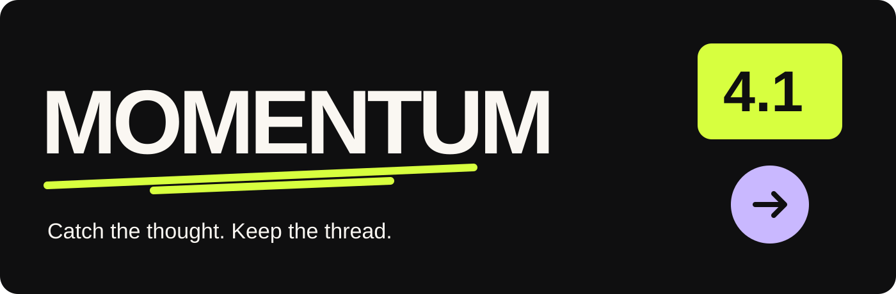
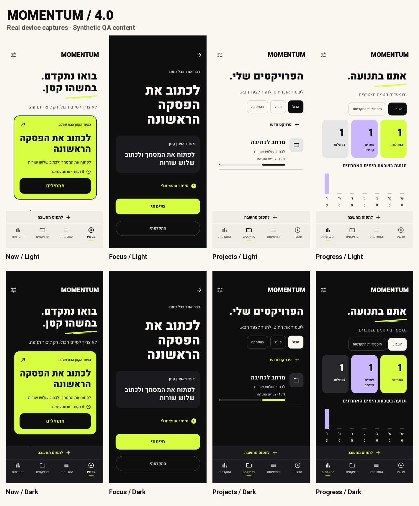
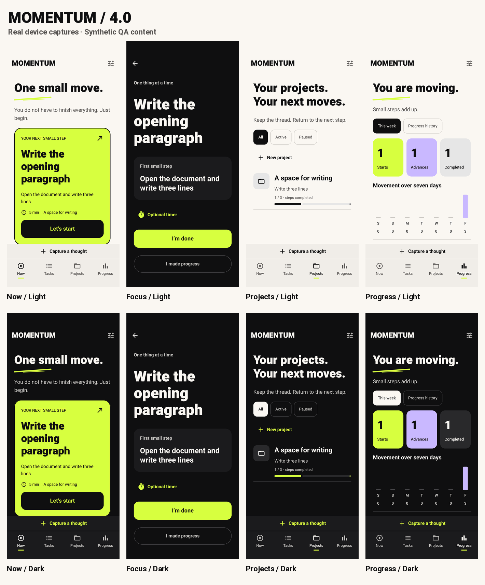
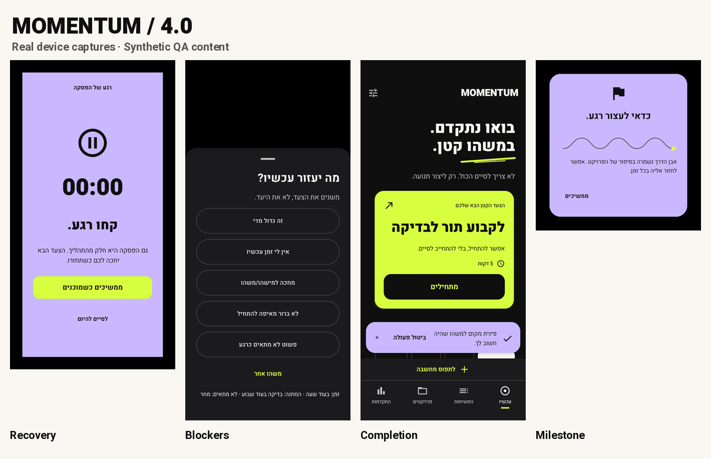
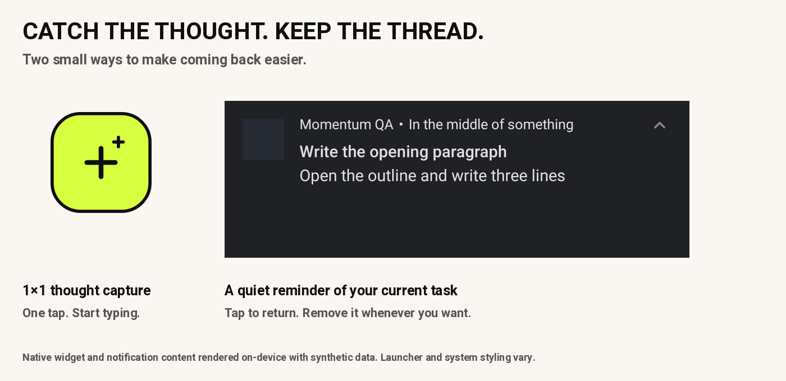

<p align="center"></p>

<h3 align="center">For the thing you meant to do.</h3>
<p align="center">Catch an idea. Find one small step. Come back to what matters.</p>

<p align="center"><a href="https://github.com/Uriel1010/momentum-android/releases/latest"><strong>Download for Android</strong></a> &nbsp; · &nbsp; <a href="https://github.com/Uriel1010/momentum-android/stargazers">★ Star Momentum</a> &nbsp; · &nbsp; <a href="https://github.com/Uriel1010/momentum-android/issues/new/choose">Suggest an improvement</a></p>

<p align="center"><strong>Offline · No account · No ads · Hebrew + English · Android 10+</strong></p>

A thought arrives while you are doing something else. You unlock your phone, get distracted, and lose the thread.

Momentum gives you a place to catch that thought—and a clear way back. Its home screen offers one manageable next action. Focus keeps that action in front of you. Your progress and next step are waiting when you return.

## Catch it. Start it. Find your way back.

| When you… | Momentum helps you… |
| --- | --- |
| Have a thought you want to keep | Tap the **1×1 capture widget** and type immediately. |
| Have plenty to do and need a starting point | Choose **one small next action** that fits your time. |
| Pick up your phone in the middle of a task | See an optional **silent assignment notification**, then tap to return. |
| Feel stuck | Make the step smaller, postpone it, or record what you are waiting for. |
| Need a break | Pause on a calm recovery screen. Continue when ready. |
| Come back after a while | Find the last progress note and the next step you left yourself. |

## A little more character. A little less friction.

Heavy Hebrew and English typography. Electric lime actions. Warm white and charcoal canvases. Lavender for a pause or a small celebration.

These are real Android app captures with synthetic example content. Light theme above, dark below; Focus stays charcoal in both.



<details><summary><strong>See the English interface</strong></summary>



</details>

<details><summary><strong>See recovery, blockers and celebrations</strong></summary>



</details>

## New in 4.1: keep the thought, keep the task



**A tiny capture widget.** Add the new 1×1 widget from Settings → Add 1×1 thought widget, then confirm placement in your launcher. One tap opens the capture sheet with the keyboard ready. The larger next-action widget is still available. Version 4.1.1 includes both a launcher preview layout and a static preview image for launcher compatibility.

**Your current assignment, quietly visible.** Open a task in Focus and choose Keep in notifications. Its title and next action stay in a silent notification. Tap to return, or choose Remove from notifications. One assignment is pinned at a time; finishing, postponing, blocking, deleting the task, or pausing its project clears it. Removing the notification does not complete the task.

Notification permission is required. Android controls lock-screen visibility and may allow you to dismiss an ongoing notification; Momentum respects that dismissal. This feature uses no always-running foreground service. Widget dimensions and placement depend on your launcher.

## Make room for real progress

- Quick capture, optional details and Android text sharing.
- Local recommendations based on readiness, time and project context.
- Focus timer, progress notes, blockers and completion with undo.
- Projects with next steps, summaries, milestones and real completion counts.
- Activity history with real starts, advances and completions. No streak penalties.
- Gentle scheduled reminders with quiet hours and limits.
- Hebrew RTL, English LTR, light/dark themes, large text and reduced motion.
- Manual JSON backup and restore.

## Your ideas can shape Momentum

Keep private ideas in **Settings → Suggestions for Momentum**. Give them a category, priority and optional screenshot. When you want to share one, choose **Prepare GitHub issue**, review the public-data notice, then review and submit the browser draft. You need a GitHub account to submit it. Nothing is published automatically; screenshots are attached manually after review.

An **issue** starts the conversation about a bug or idea. A **pull request** proposes the code that implements it. Both are welcome—see [Contributing](CONTRIBUTING.md).

**If Momentum helps you take a small step, give the repo a star.** It is a simple way to support the project and help other people discover it. A useful bug report or a thoughtful idea helps too.

## Try it

Download the APK from the [latest release](https://github.com/Uriel1010/momentum-android/releases/latest). Android will ask you to allow installation from your browser or file manager.

| Download | Choose this when… |
| --- | --- |
| **`momentum-4.1.1-release.apk`** | **You want to use Momentum.** Small, optimized, non-debuggable, private release signing. |
| `momentum-4.1.1-qa.apk` | You want a separate developer test app. It has a purple icon and creates a second installation. |
| `SHA256SUMS.txt` | You want to verify download integrity. |

Existing users can install the main release over the previous official version. Do not uninstall to work around a signing mismatch; make a backup first and check the signing identity. The optional QA APK is not needed for normal use.

## Private by design

Momentum has no internet permission, remote backend or remote analytics. Tasks, projects, suggestions and optional metrics stay local. Explicit sharing opens the browser or Android share sheet. Manual backups contain your records and attached suggestion images; choose where you save them carefully. Automatic Android backup/device transfer is disabled.

The widget and pinned notification can show task information on your phone. Pinned notifications provide a generic public version for lock screens; your Android notification settings control what is shown. [Read the privacy details](PRIVACY.md).

## Build and explore

Kotlin + Jetpack Compose, Room, DataStore and WorkManager. Use JDK 17 and Android SDK 36 with the included Gradle wrapper.

```sh
chmod +x gradlew
./gradlew assembleRelease testDebugUnitTest lintRelease

# Separate QA app and instrumentation tests:
./gradlew -PmomentumQa=true assembleDebug assembleDebugAndroidTest
```

**Validation:** 41 JVM tests and 62 device test executions passed; release lint has zero errors. Tested on one physical Android 16 device. Broader launcher and human accessibility review remain outstanding.

Release signing keys are not included. Copy build outputs before switching main/QA mode. [Developer guide](docs/DEVELOPMENT.md) · [Design system](docs/V4_VISUAL_SPEC.md) · [4.1 verification](docs/V41_QA_REPORT.md) · [Third-party notices](THIRD_PARTY_NOTICES.md)

Built for small, real actions. Improved with your feedback.
