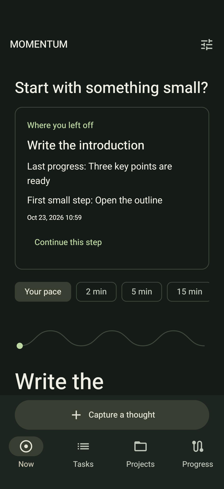
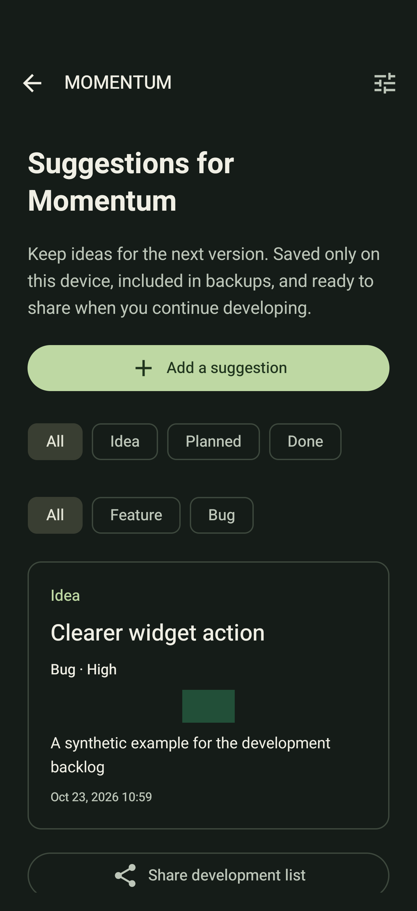
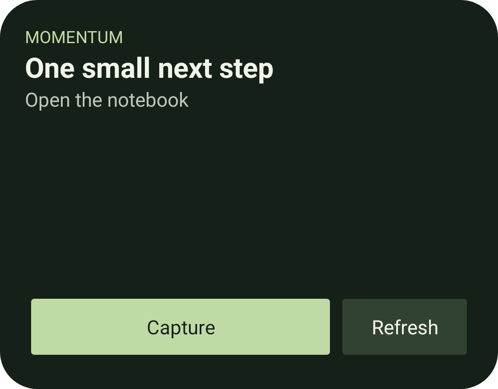

<p align="center"></p>

<p align="center"><a href="https://github.com/Uriel1010/momentum-android/releases/tag/v3.2.0">Download 3.2</a> · <a href="#a-look-inside">Screenshots</a> · <a href="#build">Build</a> · <a href="docs/DEVELOPMENT.md">Developer guide</a></p>

Momentum is a native Android app for turning a crowded mind into one manageable next step. Capture a thought, choose an action that fits, and leave a clear trail for when you return.

**Offline · Android 10+ · Kotlin / Jetpack Compose · Hebrew RTL + English · Light + dark themes**

No account, remote backend, or internet permission. Your task data stays on your device unless you explicitly export or share it.

## New in 3.2

- **A home-screen widget.** See a next action, open it, capture a thought, or refresh. Add it through Settings → Add home-screen widget. The launcher asks you to confirm placement.
- **Where you left off.** The Now screen brings back unfinished work with the last progress note and next step. Completed, waiting, future, and paused-project tasks are excluded.
- **A richer development backlog.** Suggestions now have Bug / Feature categories, Low / Normal / High priority, and one optional screenshot. Categories can be filtered; higher-priority entries appear first.
- **Deliberate GitHub sharing.** Prepare an issue, read the public-data reminder, and review it in your browser before submitting. No automatic issue submission or screenshot upload.
- **A smaller release.** The main APK is approximately 3.4 MiB, non-debuggable, optimized with R8 and resource shrinking, and signed with a private release key. The previous debug APK was roughly 61 MiB.
- **Unmistakable QA.** Developer builds use a purple icon and the name **Momentum QA**. Most people should install only the main release APK.

## A look inside

Real app captures with synthetic QA content. The widget image is the actual RemoteViews layout rendered on a physical device in a test host; launcher margins can differ.

| Pick up where you stopped | Keep your next improvement |
|:---:|:---:|
|  |  |

<p align="center"></p>

<details><summary>Core app: Now, Focus, Projects, Progress and light/dark themes</summary>

The following gallery was captured for 3.0; it shows the core design before the 3.2 additions above.


</details>

## Built around small, real actions

Capture quickly with optional details and Android text sharing. Local recommendations consider readiness, small next steps and project context. Focus offers a persistent optional timer, progress notes, blockers, and completion with undo. Projects retain summaries, milestones and resumption history. Progress shows real starts, advances and completions.

Quiet hours, reminder limits, reduced motion, optional local metrics and JSON backups keep you in control.

## Install

Download from the [3.2 release](https://github.com/Uriel1010/momentum-android/releases/tag/v3.2.0).

| File | Intended use |
| --- | --- |
| **`momentum-3.2-release.apk`** | Main app; private release signing, optimized, non-debuggable; package `com.momentum.app`. **Choose this for everyday use.** |
| `momentum-3.2-qa.apk` | Optional debug build for developers; purple Momentum QA icon; separate package `com.momentum.app.qa`. Installing both creates two apps intentionally. |
| `SHA256SUMS.txt` | Integrity hashes for both downloads. |

The release includes a verified signing lineage from the original published debug certificate. It was tested as an in-place update on Android 16, retaining the app UID and local data. It supports Android 10+; key rotation has not been device-tested on every supported Android version. An APK you built with a different debug key cannot update this installation. Do not uninstall your main app to work around a signature error: export a backup and inspect the signing identity first.

```sh
adb install -r momentum-3.2-release.apk
```

## Build

Use JDK 17, Android SDK 36 and the included Gradle wrapper. Set `ANDROID_HOME` or set `sdk.dir` in an untracked `local.properties`.

```sh
chmod +x gradlew
./gradlew assembleRelease testDebugUnitTest lintRelease
# Unsigned, optimized release: app/build/outputs/apk/release/app-release-unsigned.apk

# Separate test package; copy its outputs before changing build mode:
./gradlew -PmomentumQa=true assembleDebug assembleDebugAndroidTest
```

Release signing keys and passwords are not in this repository. See [signing and upgrade guidance](docs/DEVELOPMENT.md#signing). Windows users can use Android Studio or WSL with the supplied Unix wrapper.

## Data and privacy

Room stores records locally and DataStore stores preferences. Reminders use WorkManager. No remote analytics or advertising service is included. Optional metrics remain local and can be cleared. Automatic Android backup/device transfer is disabled; manual JSON backup is available.

Room schema **4** and backup schema **3** include suggestion categories, priorities and embedded screenshots. Database migrations retain older rows. Backups from schema 1 and 2 remain readable. A schema-1 restore preserves development suggestions because that format predates them. Schema-2 suggestions receive default category/priority and no image. Restoring newer backups replaces backed-up records, so use the confirmation carefully.

Screenshots are selected by the user, decoded and saved as resized JPEGs, stripping the original file metadata. Input limit: 10 MB; maximum dimensions: 1280 px; encoded image limit: 700,000 characters. Backups are limited to 20 MB; export rejects larger documents instead of creating an unrestorable backup. Share text does not include screenshot pixels. GitHub draft text opens only after an explicit confirmation.

## Validation

**41 JVM tests and 52 device test executions passed**, including widget capture, richer suggestions, resume behavior, database migrations, backup compatibility, reminders, denied notification permission, and three flows at 1.5× text size. Release lint completed with zero errors. Screenshots were visually reviewed.

The optimized QA APK passed an in-place signing-rotation trial and launch/capture smoke checks. The main installation passed a private on-device migration/preservation check before the non-debuggable upgrade; its UID was retained, the installed SHA-256 matched the release artifact, and it cold-launched successfully. The QA app and helper packages were then removed from the personal device.

These checks are not broad hardware certification. Human TalkBack/switch-access testing, overnight Doze behavior, and exhaustive launcher/device coverage remain outstanding. Widget refresh is event-driven while the app process runs, with platform periodic updates and an explicit Refresh button; updates are not guaranteed to be instant while Android suspends the process.

## Continue developing

Keep private ideas in Settings → Suggestions for Momentum, or deliberately share a development list. Public proposals belong in [GitHub issues](https://github.com/Uriel1010/momentum-android/issues); review private information before submitting.

[Developer guide](docs/DEVELOPMENT.md) · [Privacy](PRIVACY.md) · [Third-party notices](THIRD_PARTY_NOTICES.md)
