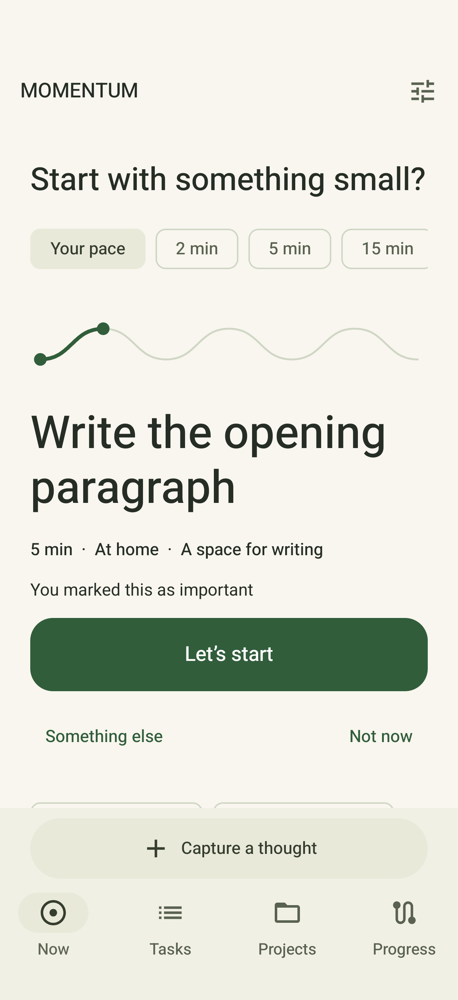
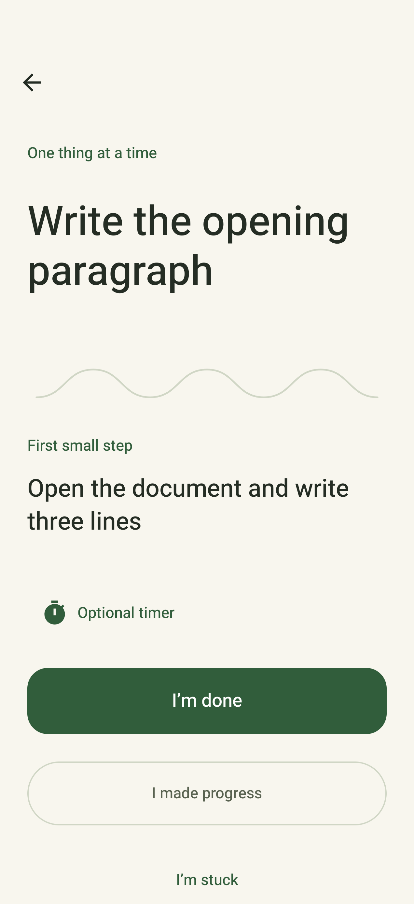
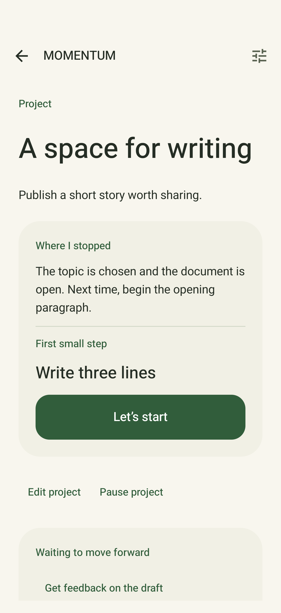
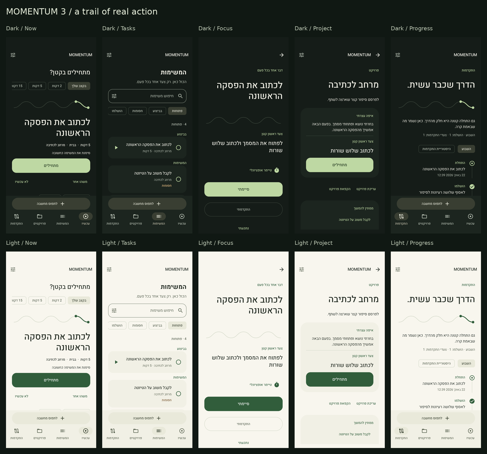
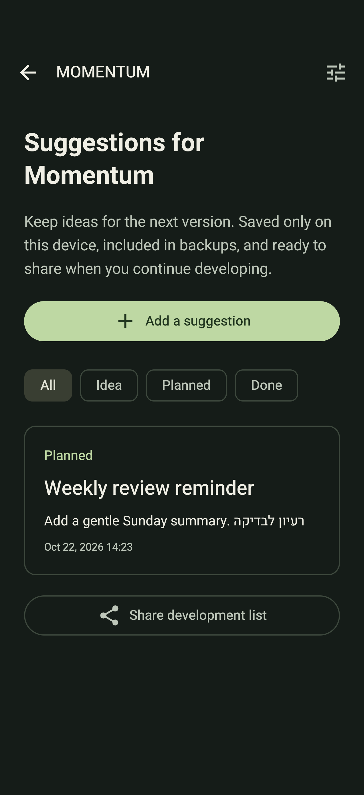
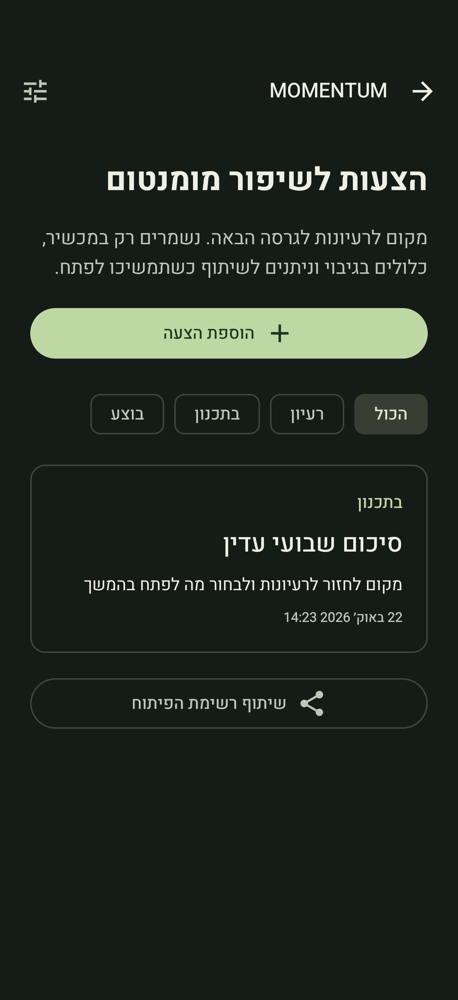

<p align="center"></p>

<p align="center">
  <a href="https://github.com/Uriel1010/momentum-android/releases"></a>
  
  
  
</p>

Momentum is a native Android app for turning a crowded mind into one manageable next step. Capture a thought, find an action that fits, and leave a clear trail for when you return.

**No account. No cloud service. No internet permission.** Hebrew with right-to-left layouts and English, with light and dark themes.

<p align="center"><a href="https://github.com/Uriel1010/momentum-android/releases/tag/v3.1.0">Download 3.1</a> · <a href="#a-look-inside">Screenshots</a> · <a href="#build-it">Build</a> · <a href="docs/DEVELOPMENT.md">Development notes</a></p>

## A look inside

Real app captures from a physical Android device, using synthetic QA content. The core screen gallery is from 3.0; the Suggestions screens below are from 3.1.

| Choose a next step | Stay with it | Return to a project |
|:---:|:---:|:---:|
|  |  |  |

<details>
<summary>Explore the Hebrew light and dark gallery</summary>



</details>

## Built around small, real actions

- **Capture quickly.** A focused capture sheet, optional details, and Android text sharing.
- **Know what to do next.** Local recommendations consider readiness, small next steps, project context, and postponement. Waiting tasks stay out of actionable recommendations.
- **Focus gently.** Optional persistent timer, explicit blockers, progress notes, and completion with undo.
- **Pick up where you stopped.** Project summaries, next steps, milestones, and resumption history.
- **See what happened.** Progress reflects starts, advances, completions, and milestones.
- **Stay in control.** Quiet hours, reminder limits, reduced motion, optional local metrics, and JSON backup/restore.

## New in 3.1: a place for the next idea

Open **Settings → Suggestions for Momentum** to keep a development backlog inside the app.

Add a title and notes, move suggestions through **Idea → Planned → Done**, edit them later, or share the whole list into your next development conversation. Entries stay on your device and are included in exported backups. Sharing opens Android’s chooser; nothing is sent automatically.

| English | עברית |
|:---:|:---:|
|  |  |

## Install

Get the APKs and `SHA256SUMS.txt` from the [3.1 release](https://github.com/Uriel1010/momentum-android/releases/tag/v3.1.0).

| APK | Use |
| --- | --- |
| `momentum-3.1-android.apk` | Main app, package `com.momentum.app`. |
| `momentum-3.1-qa.apk` | Separate QA app, package `com.momentum.app.qa`; can coexist with the main app. |

Both APKs support Android 10+ and contain the same 3.1 features. They are **debug-signed development previews**, not production-hardened store releases. QA starts with its own local data; fixture tests are run only against that package. The launcher labels are both Momentum; use Android App info to distinguish their package IDs.

For an existing installation, use an in-place update signed by the same key. Export a backup before changing signing identities. A locally rebuilt APK uses your own debug key and may not update the downloaded APK.

```sh
adb install -r momentum-3.1-android.apk
# Optional, separate test installation:
adb install -r momentum-3.1-qa.apk
```

## Build it

Use JDK 17, Android SDK 36, and the included Gradle wrapper. Set `ANDROID_HOME` or point `sdk.dir` in an untracked `local.properties` to your SDK.

```sh
chmod +x gradlew
./gradlew assembleDebug testDebugUnitTest lintDebug

# Separate app ID for safe fixture testing:
./gradlew -PmomentumQa=true assembleDebug assembleDebugAndroidTest
```

Build outputs are under `app/build/outputs/apk/`. Copy the main APK before building QA: both variants use the same output filename. On Windows, use WSL or Android Studio to run this Unix wrapper.

## Data and privacy

Room stores app records locally; DataStore stores preferences. Reminders use WorkManager. There is no remote backend or account system. Optional measurements remain local and can be cleared in Settings. Android cloud backup is disabled; user-triggered JSON export is available.

Version 3.1 adds Room schema 3 and backup schema 2. It migrates from previous database versions and reads schema-1 backups. Restoring an older backup preserves the newer development suggestions, since older backups do not contain them. Schema-2 restore replaces suggestions along with the other backed-up records. Older app versions cannot read new backups.

## Validation

For 3.1: **37 JVM tests**, **13 device tests** covering the new backlog and core storage/backup behavior, and lint with **0 errors**. The device suite covers edits, filters, draft restoration, deletion confirmation, migration, malformed backups, and legacy compatibility. English and Hebrew screenshots were visually reviewed. The main installation was also upgraded in place and checked for preservation of existing records and settings.

The 3.0 baseline additionally had broader navigation, reminder, process-restoration, and accessibility-layout checks. Those results are historical, not a claim that every scenario was rerun for 3.1. Broad hardware coverage and a human accessibility study remain future work.

## Keep developing

Use the in-app Suggestions section for private notes. For a public proposal, [open an issue](https://github.com/Uriel1010/momentum-android/issues) with the problem, a small example, and the behavior you would like to see. Do not include private task data or backups.

See [architecture and testing](docs/DEVELOPMENT.md), [privacy](PRIVACY.md), and [third-party notices](THIRD_PARTY_NOTICES.md).
