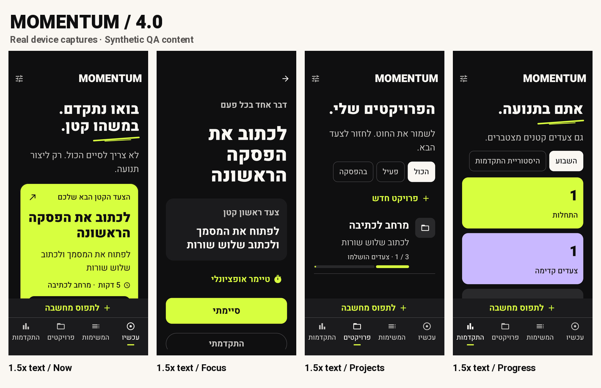

<p align="center"></p>

<p align="center"><a href="https://github.com/Uriel1010/momentum-android/releases/tag/v4.0.0">Download 4.0</a> · <a href="#a-look-inside">Screenshots</a> · <a href="#build">Build</a> · <a href="docs/V4_VISUAL_SPEC.md">Design system</a></p>

Momentum helps you move from intention to one manageable action. Capture a thought, take a small step, and leave a clear place to return.

**Native Android · Offline · Hebrew RTL + English · Light + dark · Android 10+**

No account, remote backend, ads, or internet permission. Your records stay on your device unless you explicitly export or share them.

## A new visual identity

4.0 brings heavy editorial typography, warm white, charcoal, electric lime actions, and lavender recovery. It keeps the existing tasks, projects, suggestions, reminders, widget and backup formats.

- **Now:** one dominant recommendation, a clear next action and a direct way to say you are stuck.
- **Focus:** an immersive charcoal workspace, optional timer, progress notes and a prominent completion action.
- **Recovery:** a calm lavender pause with an elapsed rest clock. Continue when ready; break time is excluded from the focus timer.
- **Projects:** editorial rows, next-step previews, active/paused filters and real completion fractions.
- **Progress:** real starts, advances and completions, a labelled seven-day chart and history. No guilt-based streaks.
- **Native details:** custom accessible controls, subtle press/motion feedback, reduced motion, font scaling and consistent RTL behavior.

## A look inside

Actual app-window captures from a physical Android device, using synthetic QA content. Top row: light system theme. Bottom row: dark. Focus stays charcoal in both.


<details><summary>English / LTR</summary>


</details>

<details><summary>Recovery, blockers and celebrations</summary>


</details>

<details><summary>Large text / 1.5×</summary>

Content remains readable and scrollable at increased text sizes; primary actions stay reachable by scrolling.



</details>

## Useful beyond the first step

Capture quickly or use Android text sharing. Local recommendations consider readiness and project context. Resume unfinished work with its last progress note. Record blockers, milestones and completions with undo. Add the native next-action widget through Settings and confirm placement in your launcher.

Keep development ideas in **Settings → Suggestions for Momentum**: Bug / Feature, priority and an optional screenshot. Preparing a GitHub issue requires a public-data confirmation and opens a browser draft for your review; it never submits or uploads images automatically.

Reminders support quiet hours and limits. Optional metrics stay local. JSON export/import provides manual backups.

## Install

Get the [4.0 release](https://github.com/Uriel1010/momentum-android/releases/tag/v4.0.0).

| File | Purpose |
| --- | --- |
| **`momentum-4.0-release.apk`** | **Everyday app.** About 3.45 MiB; optimized, non-debuggable, private release signing; `com.momentum.app`. |
| `momentum-4.0-qa.apk` | Optional developer debug build with a purple icon; `com.momentum.app.qa`. Installing it creates a second app intentionally. |
| `SHA256SUMS.txt` | SHA-256 hashes for both APKs. |

Install only the main release for normal use. The verified signing lineage supports updates from the previously published signing identity. The 3.2 → 4.0 in-place upgrade was tested on Android 16 with the same UID and unchanged storage schemas. A build signed with your own unrelated key cannot update this installation; do not uninstall to work around a signature mismatch without first making a backup.

```sh
adb install -r momentum-4.0-release.apk
```

## Build

Use JDK 17, Android SDK 36 and the included Gradle wrapper. Set `ANDROID_HOME`, or `sdk.dir` in untracked `local.properties`.

```sh
chmod +x gradlew
./gradlew assembleRelease testDebugUnitTest lintRelease
# Unsigned optimized APK: app/build/outputs/apk/release/app-release-unsigned.apk

# Isolated developer app and instrumentation:
./gradlew -PmomentumQa=true assembleDebug assembleDebugAndroidTest
```

Copy build outputs before switching between main and QA mode. Release keys and passwords are excluded from the repository. See the [developer and signing guide](docs/DEVELOPMENT.md). Windows users can use Android Studio or WSL with the supplied Unix wrapper.

## Data and privacy

Room schema **4** and JSON backup schema **3** are unchanged in 4.0. Older supported backups remain readable. Restoring a backup can replace records, so review the confirmation. Automatic Android backup/device transfer is disabled; use manual JSON export.

Suggestion screenshots are resized and stripped of original file metadata, stored locally and included in JSON backups. Exports contain readable personal data. The widget shows task text on your unlocked home screen. See [Privacy](PRIVACY.md) for storage and sharing details.

## Validation

**41 JVM tests and 63 device test executions passed.** Release lint has zero errors. Real Hebrew/English light/dark previews, 1.5× text, reduced motion, widget/suggestions, backup compatibility, reminders, denied notifications and process recovery were checked. The installed main APK matched the release hash and cold-launched; temporary QA packages were removed from the test phone.

See the [verification report](docs/V4_QA_REPORT.md) for evidence and limits. Human accessibility review, overnight Doze behavior and broader hardware/launcher coverage remain outstanding.

[Design specification](docs/V4_VISUAL_SPEC.md) · [Developer guide](docs/DEVELOPMENT.md) · [Privacy](PRIVACY.md) · [Third-party notices](THIRD_PARTY_NOTICES.md) · [Issues](https://github.com/Uriel1010/momentum-android/issues)
